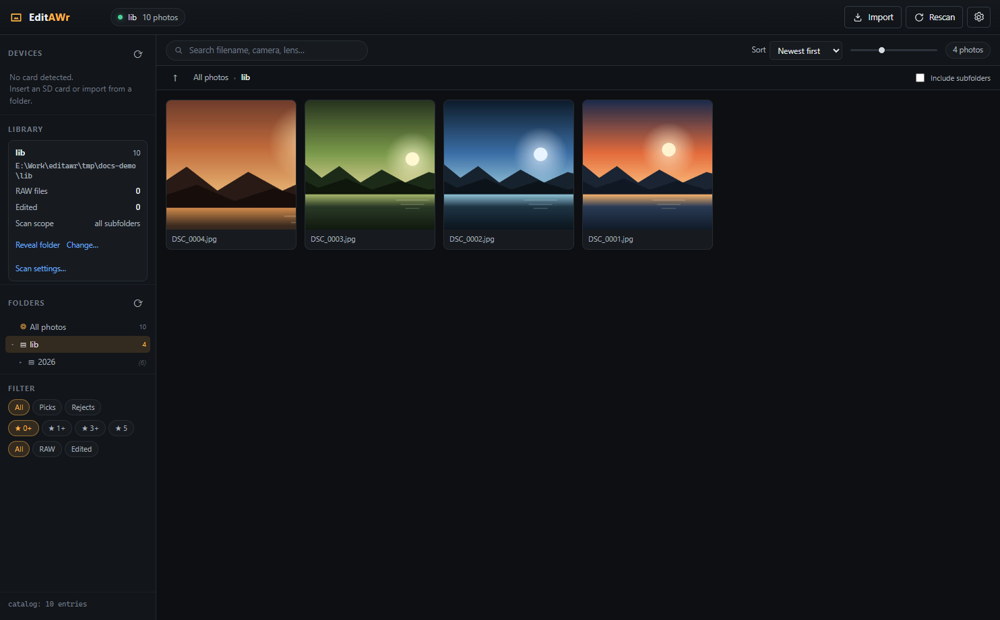
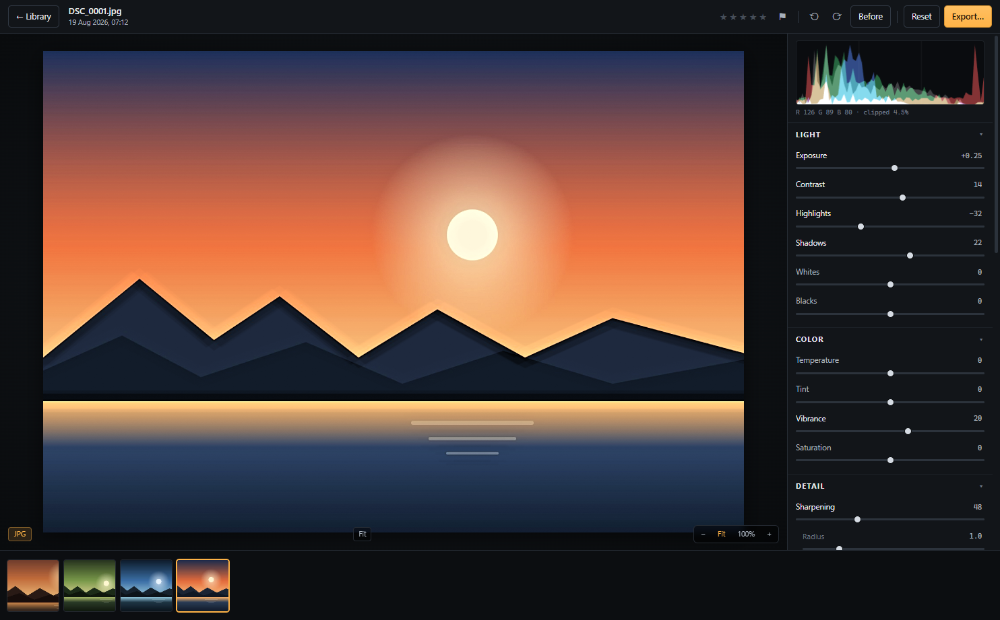
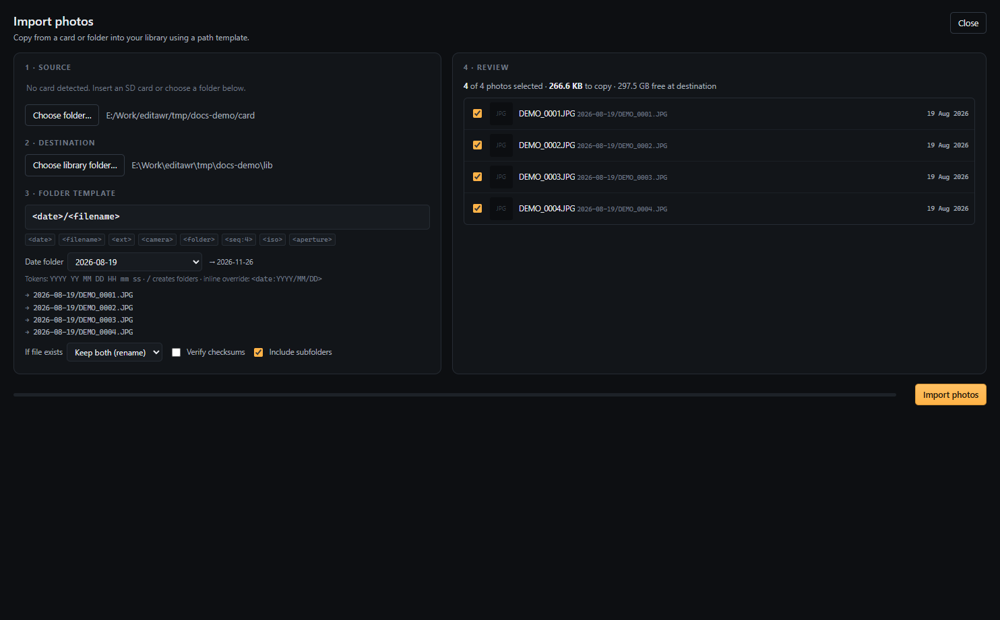

# EditAWr

A RAW-first photo organizer and editor for the desktop, built with Electron. It detects SD cards, copies photos into a library using a path template, reads Nikon NEF (and other RAW formats) through LibRaw compiled to WebAssembly, and edits on the GPU with a Lightroom-style non-destructive pipeline — including a multi-scale denoiser and a masked unsharp sharpener.







---

## Highlights

- **Card → library imports**
  - Detects removable volumes (and card readers that identify as fixed drives) and probes `DCIM` for photos.
  - Path templates such as `<date>/<filename>`, `<yyyy>/<mm>/<dd>/<camera>/<filename>`, `<original>`, `<seq:4>`, …
  - Live template preview, per-file review, duplicate handling (rename / skip / overwrite), optional sampled checksum verification, atomic copies with size verification, progress and cancellation.
  - Original file timestamps and extensions are preserved; files are never modified in place.

- **Library organizer**
  - Catalogues an existing folder in place (nothing is moved), with a JSON catalog in the app data folder.
  - **Folder browser**: a real folder tree with direct + subfolder counts, breadcrumbs, an up button (`Alt+↑`), and an “Include subfolders” scope. Clicking a folder shows only its photos; “All photos” keeps a flat view. Search and filters apply to the selected folder, and the last folder is remembered per library.
  - **Live thumbnail feedback**: while a folder's previews are generated you see a `Generating thumbnails… x/y` status pill and a spinner/shimmer on each pending tile; the queue is limited to the visible window so fast scrolling never floods a slow disk with hundreds of preview jobs.
  - EXIF capture time (with timezone offset), camera, lens, ISO, aperture, shutter, focal length, dimensions.
  - Fast thumbnails: RAW thumbnails come from the **embedded full-size JPEG preview**, not a demosaic — ~30 ms per NEF.
  - Star ratings, pick/reject flags, search, filters, sorting, virtualized grid (only visible tiles exist in the DOM), filmstrip, right-click actions.
  - Scan controls for large/slow libraries: **Stop** a running scan, **Speed up** (stop → enable fast metadata → rescan), index subfolders or top level only, skip specific folder names/relative paths, thumbnails on demand, and EXIF-less fast scans.
  - Hidden (skipped) photos stay in the catalog with their ratings and edits and come back when the rules change.
  - RAW thumbnails read only the TIFF header plus the embedded JPEG (a few MB of a 20 MB NEF) instead of the whole file.
  - Edits are non-destructive and stored per file in the catalog (sidecar XMP is not written — see roadmap).

- **Editing** (GPU, WebGL2)
  - **16-bit linear RAW pipeline** — LibRaw output is uploaded as a `RGB16UI` texture; white balance and exposure happen in linear light before tone mapping. JPEG/TIFF/PNG use the same pipeline in 8-bit.
  - Light: exposure, contrast, highlights, shadows, whites, blacks. Highlights and shadows are perceptual adjustments in display space, so they also work on JPEG and embedded HE/HE\* previews.
  - Colour: temperature (Kelvin-based), tint, vibrance, saturation, dehaze.
  - Detail: **denoise** (multi-scale wavelet shrinker: amount + detail + colour noise), **sharpening** (amount, radius, detail, masking, halo clamp), clarity, texture.
  - Effects: vignette, film grain.
  - Crop with aspect presets and drag handles, 90° rotation, before/after, histogram (R/G/B/luma + clipped %).
  - Zoom/pan with fit ↔ 100%, and automatic full-resolution RAW re-decode when you zoom in.
  - Presets, copy/paste settings, undo/redo, ratings, flags.
  - Export to JPEG / PNG / TIFF / WebP with quality, long-edge resize and a filename template. Crop + rotation are baked in; RAW is re-decoded at full resolution for export.

- **Fast and local**
  - No cloud, no telemetry, no network requests at runtime.
  - Thumbnail/preview cache with size-based pruning.
  - Handles huge libraries on slow disks: indexing is incremental, cancellable, and can skip EXIF and thumbnails (see below).

---

## Requirements

- Node.js **22.12+** (Electron 45 requirement)
- Windows 10/11, macOS 12+, or a Linux desktop with WebGL2
- GPU with WebGL2 (software fallback is not provided; a modern integrated GPU is enough)

## Quick start

```bash
npm install          # also copies LibRaw wasm into src/renderer/vendor
npm start            # or: npm run dev   (opens DevTools)
```

First run: choose a library folder (or create an empty one), then import from a card or folder. Existing photos in the chosen folder are catalogued in place.

## Import templates

Tokens are case-insensitive. `<date>` expands to **`YYYY-MM-DD`** by default, so `<date>/<filename>` produces `2026-08-19/BCD_1030.NEF`. The date format is configurable (see below).

| Token | Value |
| --- | --- |
| `<date>` | configurable — default `YYYY-MM-DD` |
| `<yyyy>` `<yy>` `<mm>` `<dd>` `<hh>` `<mi>` `<ss>` | date/time components |
| `<filename>` / `<basename>` | original filename **without** extension |
| `<name>` | original filename with extension |
| `<ext>` | extension without the dot (`NEF`) |
| `<folder>` | immediate source folder (`100NIKON`) |
| `<original>` | source-relative path (`DCIM/100NIKON/BCD_1030.NEF`) |
| `<camera>` `<lens>` `<iso>` `<aperture>` `<focal>` `<shutter>` | EXIF values, sanitized |
| `<seq>` / `<seq:4>` | per-batch sequence number (padded) |

### Date folder format

`<date>` uses a setting you can change in **Import → Date folder** or **Settings → Date folder format**:

- `YYYY-MM-DD` → `2026-08-19` (default)
- `YYYY/MM/DD` → `2026/08/19` (nested year/month/day folders)
- `YYYY/MM`, `YYYY`, `YYYYMMDD`, `DD-MM-YYYY`, `MM-DD-YYYY`
- **Custom pattern** using `YYYY YY MM DD HH mm ss` (`mm` = minutes, `MM` = month). A `/` creates subfolders; other characters are kept (illegal filename characters are stripped). Invalid patterns automatically fall back to `YYYY-MM-DD`.

You can also override the format per token without touching the setting:

```
<date:YYYY/MM/DD>/<filename>        → 2026/08/19/BCD_1030.NEF
<date:YYYY-MM-DD_HHmmss>/<filename> → 2026-08-19_065453/BCD_1030.NEF
```

Details:

- Unknown tokens are **rejected** (so `<filname>` never silently creates odd folders).
- Illegal path characters are stripped; `.`/`..` segments are removed.
- If the template does not produce an extension, the source extension is appended automatically.
- `Exports/` at the library root is never catalogued.

### Folder browser

The library is navigated like a file explorer:

- The sidebar **Folders** tree mirrors the library structure. Each row shows the number of photos *directly* in that folder; `(n)` means those photos live in its subfolders.
- Click a folder to show its photos. The **breadcrumbs** (with the **↑** button, `Alt+↑`, or clicking a crumb) move back up.
- **Include subfolders** on the right of the breadcrumb bar widens the current folder to its whole subtree.
- **All photos** at the top of the tree (or first breadcrumb) is the flat, recursive view of the library.
- Search, star/flag filters and sorting always apply **inside the current folder scope**. If a search finds nothing, the empty state offers “Search all photos”.
- The selected folder is remembered per library (in local storage) and validated when folders change; if the root has no direct photos, the app opens on “All photos” so you don't land on an empty grid.
- Folder rows/counts only include photos visible under **Scan settings** — if subfolders are not indexed, the tree tells you and links straight to the setting.

Shortcuts: `Alt+↑` goes to the parent folder; `Esc` returns from the editor to the current folder.

### Large libraries and slow disks

A 30k-file library on a spinning disk is a worst case for a scanner. EditAWr gives you three independent levers, all in **Settings → Library scanning** (or the **Scan settings…** link in the sidebar):

| Control | Effect |
| --- | --- |
| **Index photos in subfolders** (on by default) | Off: only files at the library root are scanned/shown. Subfolder entries stay in the catalog (hidden) and reappear when re-enabled. |
| **Skip folders** | Comma-separated folder names or relative paths, e.g. `backup, 2023/Originals, screenshots`. Case-insensitive; works at any depth. Hidden photos keep ratings/edits. |
| **Load thumbnails on demand** (on by default) | Scan stores names/metadata only; thumbnails are built for visible tiles. Avoids reading/decoding every image up front. |
| **Skip EXIF during scan** (off by default) | Scan records names, sizes and mtime only (fast). Camera/date/ISO metadata and thumbnails are filled in as you browse. |

While a scan is running, the scan bar offers:

- **Stop** — stops immediately. Indexed entries are saved; the next scan continues where it left off.
- **Speed up** — stops, enables *Skip EXIF during scan*, and rescans in fast mode.

Practical recipe for a 32k library on an HDD:

1. Click **Stop** on the scan bar.
2. Open **Scan settings…** in the sidebar.
3. Either turn off *Index photos in subfolders* (if the root is the only folder you want) or list the folders to skip.
4. Keep *Load thumbnails on demand* on, and enable *Skip EXIF during scan* for the first pass.
5. Rescan. Browsing loads metadata/thumbnails for what you actually look at.

Measured on a 6,000-file library (SSD): a full EXIF scan indexes ~700–900 files/s at 2 workers; the same library rescans in ~1.4 s with fast metadata + lazy thumbnails.

---

## RAW / NEF support

RAW decoding uses [LibRaw](https://www.libraw.org/) compiled to WebAssembly (`libraw-wasm`), running in a dedicated worker. Supported: NEF/NRW, CR2/CR3, ARW/SR2, DNG, RAF, ORF, RW2, PEF, SRW, X3F and the rest of LibRaw's list.

**Nikon HE / HE\* compression** (`NEFCompression >= 12`) cannot be demosaiced by current LibRaw builds, and current LibRaw releases also do not list every new body (e.g. Z50II). EditAWr detects this from the Nikon makernote and automatically edits the camera's **embedded full-size JPEG preview** instead. You will see an orange `HE/HE* preview` badge in the editor. The embedded preview is typically full resolution (5568×3712 on a Z50II), so imports, cropping, denoise, sharpening and export still work at full size — you just lose RAW highlight headroom and camera-WB flexibility for those files.

To upgrade RAW support, replace `node_modules/libraw-wasm` with a newer build (or rebuild it from LibRaw master), then `npm run vendor`. After upgrading, enable **Settings → RAW preview decoding → “Try LibRaw anyway for HE/HE* files”** so the new decoder is actually attempted for these files. The editor's validation rejects implausible demosaics and falls back to the preview rather than showing corrupted pixels.

Other formats: JPEG, PNG, WebP, AVIF, BMP, GIF and TIFF. TIFF is converted to an sRGB preview via sharp. HEIC depends on libheif/HEVC support in sharp's prebuilt libvips and often fails for iPhone HEICs.

---

## Editing pipeline

```
RAW (LibRaw 16-bit linear)  ─┐
JPEG/PNG/TIFF preview (sRGB) ─┴─► pass 1 (linear + display)
                                  white balance (Kelvin) → exposure → sRGB encode
                                  → highlights/shadows → whites/blacks
                                  → contrast S-curve → vibrance/saturation → dehaze
                                ─► RGBA8 intermediate (dithered)
                                ─► pass 2 (neighbourhood, output space)
                                  denoise (wavelet + chroma) → clarity/texture
                                  → sharpening (masked unsharp, halo clamp)
                                  → vignette → grain → dither
                                ─► canvas (preview or export size)
```

- The preview renders at display resolution (capped at ~2.6 MP of render pixels) so dragging sliders stays interactive; export renders at full resolution.
- Denoise is a **GPU multi-scale à-trous wavelet shrinker**, not a neural network. It applies a garrote threshold to the two finest detail bands, leaves the coarser bands intact (shrinking them produces broad halos around hard edges), and removes colour noise with a luma-guided chroma blur. The *Detail* slider scales the thresholds; it is fully offline and needs no model download.
  The denoiser is deliberately isolated in `FRAG2` (`denoiseColor`) in `src/renderer/js/gl.js`, so an ONNX/WebGPU model can be added as an extra pass without touching the rest of the pipeline.
- Sharpening uses two gaussian scales for radius/detail, an edge mask driven by *Masking*, and clamps the result to the local tonal range to suppress halos.
- Radius values are in output pixels, so what you see at fit/100% is what you get on export (subject to resolution differences).

## Export

`Export…` in the editor (or `Ctrl+E`):

- Formats: JPEG (`mozjpeg`, quality 40–100), PNG, TIFF (deflate), WebP.
- Long-edge resize, filename template (same tokens as imports), custom folder (defaults to `<library>/Exports`).
- RAW is re-decoded at full size for export; crop and rotation are applied at full resolution.

## Keyboard shortcuts

| Keys | Action |
| --- | --- |
| `Ctrl/Cmd+O` | Open/switch library |
| `Ctrl/Cmd+Shift+I` | Import from card |
| `Ctrl/Cmd+E` | Export current photo |
| `F5` | Rescan library |
| `Enter` | Open photo in editor |
| `← ↑ → ↓` | Move selection / previous & next photo |
| `Alt+↑` | Go up one folder |
| `0–5` | Star rating |
| `P` / `X` / `U` | Pick / reject / clear flag |
| `[` `]` | Rotate 90° |
| `\` | Before / after |
| `C` | Crop tool |
| `F` / `+` / `-` | Fit / zoom in / zoom out |
| `Ctrl+0` / `Ctrl+1` | Fit / 100% |
| `Ctrl+Z` / `Ctrl+Shift+Z` | Undo / redo edits |
| `Esc` | Back to library |

## Where things are stored

- Settings: `<userData>/settings.json`
- Catalog: `<userData>/catalogs/<hash>.json` (one per library root)
- Thumbnails: `<userData>/thumbs/`
- Full-size previews: `<userData>/previews/`

`<userData>` is `%APPDATA%/EditAWr` on Windows, `~/Library/Application Support/EditAWr` on macOS, `~/.config/EditAWr` on Linux. Photos themselves are never modified; the only writes inside a library are imports and exports.

## Architecture

```
src/main/            Electron main process (Node)
  main.js            lifecycle, window, menu
  protocol.js        app://, photo://, thumb:// secure protocols
  ipc.js             validated IPC surface
  settings.js        atomic JSON settings
  drives.js          SD/removable volume detection + polling
  library.js         scan/index/catalog loop
  catalog.js         per-library JSON database
  metadata.js        exifr wrapper, wall-clock EXIF dates
  tiff-preview.js    TIFF IFD walker → embedded JPEG previews
  thumbs.js          thumbnail + preview cache (sharp)
  template.js        import path template engine
  importer.js        scan/plan/copy with conflicts + verification
  exporter.js        format conversion/encoding (sharp)
  util.js            walk/atomic-write/hash/semaphore helpers

src/preload/         contextBridge API (no Node in renderer)
src/renderer/
  index.html, css/   UI
  js/app.js          shell, folder browser, shortcuts, settings, menus
  js/grid.js         virtualized photo grid (folder-scoped list)
  js/editor.js       loupe UI, crop, histogram, export
  js/gl.js           WebGL2 two-pass image pipeline
  js/raw.js          LibRaw worker client
  workers/raw-worker.js  LibRaw wasm decode + validation
  vendor/libraw/     LibRaw wasm copied by scripts/vendor.js

scripts/
  vendor.js          copies libraw-wasm into the renderer
  e2e-app.js         full end-to-end Electron test
```

Security: `contextIsolation`, `sandbox`, no `nodeIntegration`, a strict CSP, a custom `app://` scheme instead of `file://`, and a `photo://` protocol restricted to allow-listed roots. IPC handlers return `{ok, data}`/`{ok:false, error}` and validate paths.

## Tests

```bash
npm test            # unit tests (node:test): templates, TIFF previews, metadata,
                    # import planning/copying, export, cache, catalog, walker

# Full end-to-end (launches the real app, drives it, checks exported files):
EDITAWR_TEST_NEF="C:/path/to/HE_star.NEF" \
EDITAWR_TEST_RAW="C:/path/to/decodeable.NEF" \
npm run test:e2e
```

The E2E run verifies: JPEG editing, HE\* preview fallback, full-resolution HE\* export, LibRaw 16-bit RAW decode, an aggressive multi-slider render, cropped/rotated/resized full-res RAW export, rating persistence, and a card → library import.

Unit tests that need real camera files are skipped unless the environment variables above are set. Test fixtures are read-only; everything else is written under `tmp/` (gitignored).

## Packaging

Installers are built with electron-builder. See **[docs/BUILDING.md](docs/BUILDING.md)** for per-platform requirements, native-module notes, signing/notarization, CI artifacts and troubleshooting.

```bash
npm ci
npm run pack        # unpacked app for the current OS
npm run dist        # installer(s) for the current OS
```

GitHub Actions packages Windows x64, Linux x64 and macOS on `v*` tags or a manual workflow run. Because `sharp` uses host-specific native binaries, each platform should be built on its own OS.

## Known limitations / roadmap

- Nikon HE/HE\* and brand-new bodies unsupported by LibRaw fall back to the embedded JPEG preview (clearly indicated).
- No XMP sidecars (edits live in the catalog). Importing the same files on another machine will not carry edits.
- No batch export/rename, no collections/keywords, no tethered capture.
- Denoise is a classical GPU wavelet shrinker; a neural denoiser hook (ONNX Runtime Web / WebGPU) is the main planned upgrade.
- HEIC support depends on the platform codec; iPhone HEVC HEICs usually cannot be decoded.
- No destructive edits, no file deletion, no cloud sync — by design.

## License

MIT. LibRaw is LGPL-2.1/CDDL, libraw-wasm ISC, sharp Apache-2.0, exifr MIT. See the respective packages for details.
